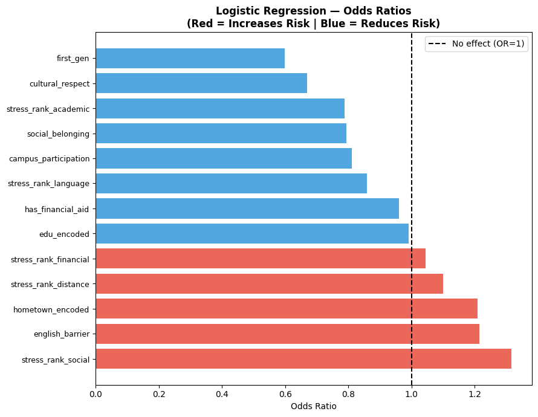
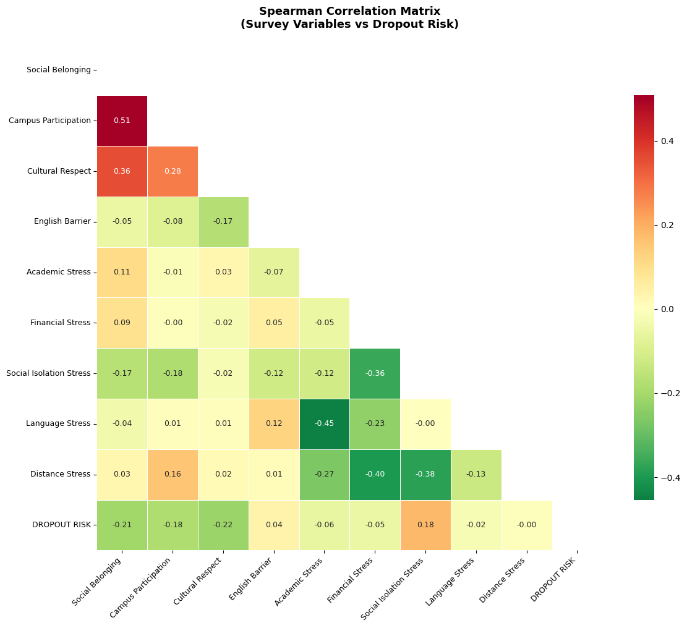

# Who Thinks About Leaving? Dropout Risk at Pakistan's Elite Universities

A survey study of what drives students at GIKI, LUMS, NUST and AKU to consider dropping out or transferring, framed around Tinto's student integration model and Bourdieu's idea of cultural capital. The findings are checked against an international dataset of 3,600+ students.

**Analysis and code:** Aiman Nowrooz
**Research team:** _names to be added_
**Year:** 2025–2026



## Research questions

1. Does cultural capital (first-generation status, hometown, schooling) relate to dropout intention?
2. Do risk levels and stressors differ across the four universities?
3. Which social and financial factors are most associated with dropout intention?
4. Do university support services make a difference?

## Data and method

- **228 survey responses** across four universities, covering social belonging, campus participation, cultural respect, language barriers, a ranking of five stressors, support service use, and how often the student has seriously considered leaving.
- **Outcome:** "Sometimes" or "Frequently" considering leaving = high risk (33.3% of respondents); "Never" or "Rarely" = low risk.
- **Analysis:** Spearman correlations, Kruskal–Wallis tests across universities, chi-square for support services, VIF multicollinearity checks and logistic regression with odds ratios.
- **Validation:** the same approach applied to the UCI/Kaggle *Predict Students' Dropout and Academic Success* dataset (N = 3,630).

## Key findings

- **Belonging matters most.** Students who felt they belonged, felt their culture was respected and found it easy to join campus life were less likely to consider leaving (Spearman r between −0.19 and −0.22, all p < 0.01). Social isolation was the only stressor linked to higher risk (r = 0.18).
- **Cultural respect is the strongest single predictor** in the regression model (odds ratio 0.67, p = 0.013).
- **Risk differs by university.** High-risk rates ranged from 19.7% (LUMS) to 47.1% (GIKI).
- **A surprising result:** first-generation students reported *lower* dropout intention (OR 0.60, p = 0.024). This runs against the cultural capital hypothesis and is worth testing with a larger first-gen sample (n = 25 here).
- **Support services showed no significant effect** (χ² = 0.76, p = 0.38). This suggests generic support may not address the social and cultural struggles students describe.



## Limitations

- The five stressors were **ranked**, so each respondent's ranks always add up to 15. That makes them perfectly collinear (VIF = ∞), and their individual regression coefficients can't be interpreted. A future version should drop one rank as a reference category or ask for independent ratings.
- The model's held-out ROC-AUC is 0.50. The survey reveals **associations**, but it can't yet **predict** which individual students are at risk. By contrast, the validation model reaches 0.91, mainly because that dataset includes academic performance.
- The study uses self-reported intention, not actual dropout. It is a convenience sample, and AKU has only 16 responses.

## Repository

```
notebooks/dropout_risk_analysis.ipynb   full analysis, with outputs from the real data
data/sample_survey.xlsx                 synthetic sample with the same structure (see data/README.md)
figures/                                charts exported from the analysis
```

Row-level previews of the real responses have been removed from the notebook outputs. Only aggregate results are shown.

## Run it

```bash
pip install -r requirements.txt
cd notebooks
jupyter notebook dropout_risk_analysis.ipynb
```

The survey analysis runs on the synthetic sample by default. For the validation section, download the dataset described in `data/README.md`. The notebook also runs in Google Colab, where it asks you to upload the files.
